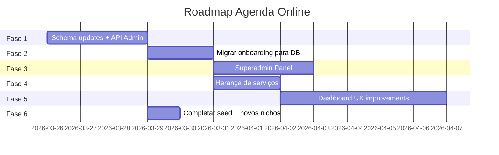

# Plano de Melhoria e Escala — Agenda Online

> Documento estratégico de produto · v1.0 · 2026-03-25

---

## 1. Diagnóstico Atual

### Arquitetura Existente

| Camada | Estado | Problema |
|--------|--------|----------|
| **DB Schema** | ✅ Global taxonomy tables existem (`business_types`, `global_categories`, `global_services`, `global_placeholders`) | Não está conectado ao onboarding/dashboard |
| **Seed Script** | ⚠️ `seed-taxonomy.ts` só cobre 6 dos 14 business types | 8 nichos faltando no seed |
| **Onboarding** | ⚠️ Funcional mas com defaults hardcoded em `tenant-defaults.ts` (419 linhas) | Não usa as tabelas globais do DB |
| **Dashboard** | ✅ Layout profissional com sidebar + bottom bar | Faltam módulos e não reflete business type |
| **Serviços** | ⚠️ Gerenciamento local por tenant | Não herda templates globais |
| **API Admin** | ❌ Não existe | Sem CRUD para business types/services/placeholders |

### Fluxo Atual

```
Onboarding → tenant-defaults.ts (hardcoded) → cria tenant → dashboard
                    ↓
            NÃO consulta DB global taxonomy
```

### Fluxo Ideal

```
Admin API → grava em business_types/global_categories/global_services/global_placeholders
                    ↓
Onboarding → consulta DB global → preenche templates → cria tenant com defaults do DB
                    ↓
Tenant Dashboard → herda categorias/serviços/placeholders globais como templates editáveis
```

---

## 2. Roadmap de Melhorias

### FASE 1: API Global de Taxonomia (Backend Foundation)

> **Objetivo:** CRUD completo para gerenciar business types, categorias, serviços e placeholders via API do admin.

#### 2.1 API Routes

| Rota | Método | Descrição |
|------|--------|-----------|
| `/api/admin/business-types` | GET, POST | Listar e criar tipos de negócio |
| `/api/admin/business-types/[id]` | GET, PUT, DELETE | Detalhar, editar, remover |
| `/api/admin/business-types/[id]/categories` | GET, POST | Categorias do business type |
| `/api/admin/business-types/[id]/categories/[catId]` | PUT, DELETE | Editar/remover categoria |
| `/api/admin/business-types/[id]/services` | GET, POST | Serviços do business type |
| `/api/admin/business-types/[id]/services/[svcId]` | PUT, DELETE | Editar/remover serviço |
| `/api/admin/business-types/[id]/services/[svcId]/placeholder` | PUT | Editar placeholder |

#### 2.2 Segurança

- Todas as rotas protegidas por `role === "admin" || role === "superadmin"`
- Middleware de autenticação + verificação de role
- Rate limiting na API

#### 2.3 Schema Updates

- Adicionar `description`, `emoji` e `sortOrder` em `business_types`
- Adicionar `defaultPrice` em `global_services`
- Adicionar `defaultDescription` em `global_services` (texto curto do serviço)

```sql
ALTER TABLE business_types ADD COLUMN description TEXT;
ALTER TABLE business_types ADD COLUMN emoji TEXT;
ALTER TABLE business_types ADD COLUMN sort_order INTEGER DEFAULT 0;
ALTER TABLE global_services ADD COLUMN default_price NUMERIC(10,2);
ALTER TABLE global_services ADD COLUMN default_description TEXT;
```

---

### FASE 2: Migrar Onboarding para DB Global

> **Objetivo:** Eliminar `tenant-defaults.ts` hardcoded. Onboarding consulta DB.

#### 2.4 Refatorar `tenant-defaults.ts`

| Antes | Depois |
|-------|--------|
| `BUSINESS_TYPE_MAP` hardcoded (14 entries) | Query `business_types` table |
| `NICHE_CONTENT` hardcoded (14 entries) | Query `business_types` + metadata |
| `getNicheCategories()` hardcoded | Query `global_categories WHERE business_type_id` |
| `getNicheServices()` hardcoded | Query `global_services + global_placeholders` |

**Novo fluxo:**

```typescript
// lib/taxonomy.ts (novo)
export async function getBusinessTypes() {
  return db.select().from(businessTypes).orderBy(businessTypes.sortOrder)
}

export async function getCategoriesForType(businessTypeId: string) {
  return db.select().from(globalCategories)
    .where(eq(globalCategories.businessTypeId, businessTypeId))
    .orderBy(globalCategories.sortOrder)
}

export async function getServicesForType(businessTypeId: string) {
  return db.select().from(globalServices)
    .leftJoin(globalPlaceholders, eq(globalPlaceholders.globalServiceId, globalServices.id))
    .where(eq(globalServices.businessTypeId, businessTypeId))
    .orderBy(globalServices.sortOrder)
}
```

#### 2.5 Onboarding UI Melhorias

| Melhoria | Descrição |
|----------|-----------|
| **Step 1 dinâmico** | Carregar nichos do DB ao invés de const hardcoded |
| **Preview inteligente** | Ao selecionar niche, mostrar preview dos serviços que serão criados |
| **Validação melhorada** | WhatsApp com máscara, slug availability check em real-time |
| **Progress persistence** | Salvar progresso do onboarding no localStorage |
| **Mobile-first** | Ajustar sizing e spacing dos cards de niche para thumb-friendly |

---

### FASE 3: Dashboard Administrativo Global (Superadmin Panel)

> **Objetivo:** Interface para gerenciar a taxonomia global sem precisar de seed scripts.

#### 2.6 Nova Rota `/painel/admin/taxonomia`

- Tela de gestão com tabs: Business Types | Categorias | Serviços | Placeholders
- CRUD visual com drag-and-drop para ordenação (`sortOrder`)
- Preview de como os defaults aparecerão para o tenant final
- Bulk import/export via JSON

#### 2.7 Permissões

| Role | Acesso |
|------|--------|
| `user` | Dashboard do tenant (atual) |
| `admin` | Dashboard do tenant + Admin panel |
| `superadmin` | Tudo + gestão de taxonomia global |

---

### FASE 4: Herança de Serviços (Tenant ← Global)

> **Objetivo:** Quando um tenant é criado, ele herda os serviços globais como templates editáveis.

#### 2.8 Fluxo de Herança

```
1. Tenant criado com businessTypeId = "bt-barbearia"
2. Sistema busca global_categories WHERE business_type_id = "bt-barbearia"
3. Cria categories no tenant (cópia local, editável)
4. Sistema busca global_services para cada category
5. Cria services no tenant com:
   - name = global_service.name
   - description = global_placeholder.placeholder_text
   - duration = global_service.default_duration
   - price = global_service.default_price
   - categoryId = tenant_category.id (local)
```

**O tenant NUNCA referencia as globais diretamente após a criação** — ele tem cópias locais que pode editar livremente.

#### 2.9 Atualização em Cascata (Futuro)

- Opção para admin "propagar" alterações globais para tenants existentes
- Flag `isCustomized` no serviço do tenant para saber se foi editado manualmente
- Tenant pode escolher "resetar para padrão" individualmente

---

### FASE 5: Dashboard UX/UI Improvements

> **Objetivo:** Tornar o dashboard mais completo, intuitivo e adaptado ao business type.

#### 2.10 Melhorias Imediatas

| Área | Melhoria |
|------|----------|
| **Painel principal** | KPI cards (agendamentos hoje, semana, mês), gráfico de tendência |
| **Serviços** | Agrupamento visual por categoria, drag-and-drop reorder |
| **Agenda** | Calendar view (dia/semana/mês), integração com WhatsApp |
| **Sidebar** | Badge de "novo" em módulos recém-adicionados |
| **Mobile** | Bottom sheet para ações rápidas, pull-to-refresh |

#### 2.11 Novos Módulos

| Módulo | Prioridade | Descrição |
|--------|------------|-----------|
| **Clientes** | Alta | CRM básico com histórico de agendamentos |
| **Equipe** | Média | Gestão de profissionais/funcionários |
| **Relatórios** | Média | Faturamento, horários mais agendados, taxa de cancelamento |
| **Notificações** | Alta | Lembretes por WhatsApp/SMS para clientes |
| **Integrações** | Baixa | Google Calendar, Instagram, iCal |

---

### FASE 6: Seed Script Completo

> **Objetivo:** Completar o seed com todos os 14 business types existentes + novos.

#### 2.12 Business Types Faltando no Seed

| Niche | Status |
|-------|--------|
| Salão de Beleza | ✅ No seed |
| Barbearia | ✅ No seed |
| Studio de Estética | ✅ No seed |
| Clínica de Estética | ✅ No seed |
| Nail Designer | ✅ No seed |
| Studio de Sobrancelhas | ✅ No seed |
| **Tatuagem e Piercing** | ❌ Faltando |
| **Massagem e SPA** | ❌ Faltando |
| **Pet Shop** | ❌ Faltando |
| **Health & Fitness** | ❌ Faltando |
| **Educação e Aulas** | ❌ Faltando |
| **Fotografia** | ❌ Faltando |
| **Manutenção e Reparos** | ❌ Faltando |
| **Outros** | ❌ Faltando |

---

## 3. Prioridade de Execução



### Ordem Recomendada

1. **FASE 6** → Completar seed (rápido, desbloqueia tudo)
2. **FASE 1** → Schema updates + API
3. **FASE 2** → Migrar onboarding
4. **FASE 4** → Herança de serviços
5. **FASE 3** → Superadmin panel
6. **FASE 5** → Dashboard improvements (iterativo)

---

## 4. Decisões de Arquitetura

| Decisão | Escolha | Justificativa |
|---------|---------|---------------|
| **Herança de serviços** | Cópia local (snapshot) | Tenant pode editar sem afetar global |
| **Business type content** | No DB, não em código | Escalável, editável sem deploy |
| **Admin panel** | Mesmo app, rota protegida | Sem necessidade de app separado |
| **Placeholder system** | 1:1 com global_service | Cada serviço tem um template de descrição |
| **Onboarding data** | DB query, cache 5min | Performance OK para volume atual |

---

## 5. Métricas de Sucesso

| Métrica | Antes | Meta |
|---------|-------|------|
| Nichos suportados | 14 (hardcoded) | Ilimitados (via DB) |
| Tempo para adicionar niche | Deploy necessário | Admin panel em 2 min |
| Onboarding completion rate | Desconhecido | >70% |
| Serviços pré-populados | Fixos por niche | Dinâmicos + editáveis |
| Admin CRUD | Inexistente | API RESTful completa |
